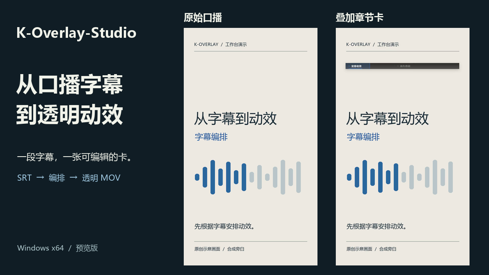

# K-Overlay-Studio

**把口播字幕变成能在剪映里叠加的动效卡。** 用自己的 AI Agent 从 20 张卡中挑选和编排，在 Windows 工作台里逐帧改字、调整位置，再导出透明 MOV。支持 9:16 竖屏和 16:9 横屏。

[](docs/media/demo.mp4)

**[下载 Windows x64 预览包](https://github.com/Kaigmail/k-overlay-studio-public/releases/download/v0.1.0-preview.2/K-Overlay-Studio-v0.1.0-preview.2-windows-x64.zip)**　·　**[跟着随包示例做一遍](WINDOWS.md)**

公开版限非商业用途。Windows 桌面版需要 WebView2、.NET Framework 4.6.2 或以上、Node.js 22.12 或以上及 FFmpeg。首次安装需要联网。

## 复制该提示词给你的 Agent，由 Agent 自行安装好这个项目

把下面整段复制给能操作本机终端的 Agent，例如 Codex 或 Claude Code。

```text
请在这台电脑上安装并启动 K-Overlay-Studio，让我可以直接试用。
官方仓库是 https://github.com/Kaigmail/k-overlay-studio-public 。请先阅读仓库的 AGENTS.md 和 WINDOWS.md，再执行安装。
我接受 Windows x64 预览版。请选择已发布且含 Windows x64 ZIP 的最新版本（包括预发布版），从同一个 Release 下载 ZIP 和 SHA256SUMS.txt，核对哈希。
检测并补齐缺少的依赖，保留我已有的项目和素材，在新的英文无空格目录安装。遇到系统提权或需要重启时告诉我原因。
请实际启动桌面工作台，用随包示例验证可以编辑并导出一个透明 MOV。完成后告诉我版本号、安装路径、下次怎么打开，以及验证结果。
```

## 第一次用，从改一句话开始

随包的 7 秒示例包含字幕、编排和带旁白的竖屏底片。打开示例编排，把章节条的「字幕编排」改成「安排动效」，循环看一遍，再导出透明 MOV。你可以在准备页恢复本机草稿，也可以导出 JSON 留作另一版。剪映中把 MOV 放在底片上方即可合成。

## 让自己的 Agent 配卡

在解压目录或源码根目录打开 Codex、Claude Code 或其他支持读取本地文件的 Agent，复制下面这段话。也可以在工作台选择自己的字幕，然后点「复制给 Agent」取得本期路径。

> 读取 release-demo/demo.srt 和仓库自带的 overlay-fx-generator 编排规则，为这段字幕生成一份 9:16 动效编排。卡面文字与数字须有字幕依据。另存为 release-demo/my-overlay.json，保留官方示例。进入 motion-playground 执行 npm run -s lint:overlay -- ../release-demo/my-overlay.json --duration 7。告诉我交稿路径、检查结果以及需要我判断的地方。

回到准备页，选同一份 SRT，再点「选择 JSON 文件」打开 my-overlay.json。核对画幅、卡数和提示后点「应用到时间轴」。你可以用官方编排对照两种选卡思路。

## 从源码运行

在项目根目录执行：

```bash
node extra/restore-assets.mjs
cd motion-playground
npm ci
npm run dev
```

打开 http://localhost:5177。透明导出还需要 FFmpeg、ffprobe 与 Puppeteer 使用的浏览器。需要自行编译 Windows 桌面启动器时，在同一目录执行 `npm run build:desktop`。修改卡片或代码后运行 `npm run build` 和 `npm run check:cards`。

## 署名与使用范围

K-Overlay-Studio 由作者基于一页枝鸥（Jessie Zhou）的 [Overlay Studio](https://github.com/jeszhou/overlay-studio) 源码公开版二次开发。仓库保留原作者署名。

本发布版仅供学习和个人非商业使用。Windows 版可在 [GitHub Releases](https://github.com/Kaigmail/k-overlay-studio-public/releases) 免费下载。
